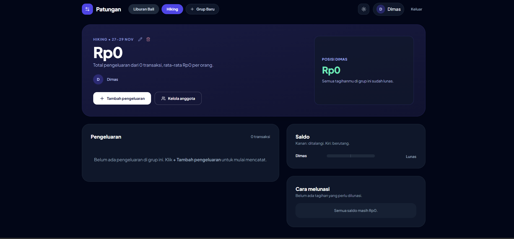

# Patungan - Aplikasi Bagi Tagihan & Pengeluaran Bersama

<p align="center">
  
</p>

**Patungan** adalah aplikasi web yang dirancang untuk memudahkan pencatatan, perhitungan, dan pelunasan pengeluaran bersama (seperti liburan, acara kantor, kos bulanan, atau makan bareng) secara transparan dan adil. Dilengkapi dengan sistem manajemen akun aman, pembagian rata otomatis, algoritma penyederhanaan utang, serta tampilan responsif dengan tema Terang/Gelap.

---

## Fitur

* Autentikasi & Keamanan Akun: Register, Login, Lupa Password, Logout, enkripsi password (Bcrypt), isolasi data per pengguna, dan manajemen sesi aman (HTTP-Only cookies).
* Manajemen Grup: Buat, edit, dan hapus grup (hard delete dengan cascade deletes), otomatis memasukkan pembuat grup sebagai anggota pertama, serta merapikan urutan ID otomatis (re-sequencing).
* Manajemen Anggota: Tambah dan ubah nama anggota, warna identifikasi avatar otomatis, serta proteksi minimal 1 anggota dalam grup.
* Pencatatan Pengeluaran: Input, edit, dan hapus pengeluaran beserta kategori, tanggal, pembayar (paid by), dan peserta patungan.
* Pembagian Otomatis: Kalkulasi patungan merata dengan penanganan sisa pembagian ganjil hingga satuan rupiah terkecil.
* Penyederhanaan Utang: Kalkulasi saldo (paid vs owed), indikator "POSISI KAMU", algoritma greedy matching untuk meminimalkan jumlah transfer, serta fitur Tandai Lunas dan pembatalan pelunasan.
* UI/UX & Waktu: Tema Light/Dark Mode, antarmuka responsif, indikator loading, dan penyeragaman zona waktu GMT+7.   

---

## Teknologi

* **Frontend:** HTML5, Tailwind CSS (via CDN), Lucide Icons, JavaScript Modern (ES Modules).
* **Backend:** Node.js, Express.js, Express-Session, Zod, Bcrypt.
* **Database:** SQLite (`node:sqlite`)
* **Autentikasi:** Sesi + HTTP-Only Cookie 

---

## Struktur Project

---

patungan-app/
├── docs/
│   └── dashboard-patungan.png
│
├── data/
│   └── database.sqlite             # Database SQLite
│
├── public/
│   ├── app.js                      # Frontend & Interaksi API
│   ├── index.html                  # Halaman Dashboard Utama
│   └── login.html                  # Halaman Login, Register, & Lupa Password
│
├── .env                            # Konfigurasi Environment Server
├── package.json                    # Daftar dependensi & skrip Node.js
└── server.js                       # Konfigurasi Backend Express & API SQLite

---

## Cara Menjalankan Project http://localhost:3000

1. Pastikan **Node.js versi 22.5+** sudah terpasang (`node -v`).

2. **Pastikan file .env sudah ada**
   PORT=3000
   SESSION_SECRET=kunci-rahasia-patungan

3. **Instal Dependensi:**
   ```bash
   npm install
   ```
4. **Jalankan server:**
   ```bash
   npm run dev
   ```

   